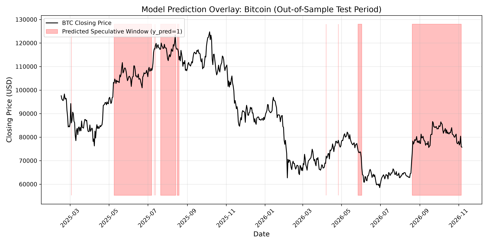

<p align="center">
  
</p>

<h1 align="center">OBSIDIAN</h1>

<p align="center">
  <strong>Sub-Millisecond Quantitative Finance Platform & Distributed Transactional Lakehouse</strong><br>
  <em>Engineered for ultra-low latency market ingestion, SIMD behavioral alpha modeling, and real-time execution.</em>
</p>

<p align="center">
  <a href="https://github.com/AlphaSparrow/obsidian/actions/workflows/ci.yml"></a>
  <a href="https://github.com/AlphaSparrow/obsidian/actions/workflows/pr_hygiene.yml"></a>
  <a href="https://github.com/AlphaSparrow/obsidian/actions/workflows/codeql.yml"></a>
  <a href="https://opensource.org/licenses/Apache-2.0"></a>
  <a href="https://en.cppreference.com/w/cpp/20"></a>
  <a href="docs/architecture/"></a>
  <a href="http://127.0.0.1:8080"></a>
</p>

<p align="center">
  <a href="#-subsystems--architecture">Subsystems</a> •
  <a href="#-live-trading-station--web-terminal">Live Terminal</a> •
  <a href="#-quantitative--behavioral-models">Quant Models</a> •
  <a href="#-quickstart--local-building">Quickstart</a> •
  <a href="#-ci--cd-pipeline">CI/CD</a> •
  <a href="#-contributing">Contributing</a>
</p>

---

## 🏛️ Subsystems & Architecture

Obsidian couples a bare-metal C++20 transactional runtime with behavioral machine learning and real-time algorithmic execution:

- **Kernel Subsystem (`kernel/`)**: Lock-free LMAX-style Disruptor ring buffers, 64-byte cacheline-aligned memory pools, NUMA-aware arenas, and a work-stealing threadpool dispatcher.
- **Compute Subsystem (`compute/`)**: Runtime SIMD vectorization (AVX-512, AVX2, NEON), numerical pricing kernels, and vectorized Cumulative Prospect Theory (CPT) probability weighting.
- **Quantitative Modeling (`compute/quant/`)**: GARCH(1,1) & RiskMetrics EWMA volatility forecasting with dynamic regime switching, multi-method Value-at-Risk (Parametric, Cornish-Fisher expansion, Historical), Expected Shortfall (CVaR), and Ledoit-Wolf regularized Risk Parity (Equal Risk Contribution) portfolio allocation.
- **Storage Subsystem (`storage/`)**: Lakehouse transactional engine featuring Arrow columnar batching, optimistic concurrency control (OCC), manifest snapshot management, data skipping, Gorilla/Delta-Delta codecs, mmap journaling with torn-write recovery, and DuckDB/ClickHouse zero-copy bridges.
- **Runtime Subsystem (`runtime/`)**: EventBus with lock-free topic dispatch, 8-state component lifecycle registry, task DAG scheduling, nanosecond-precision deterministic clock, streaming backpressure pipelines, and native C++ decision forest inference.
- **Strategy & Execution Engines (`engines/`)**: `IStrategy` engine lifecycle, CPT Breakout momentum strategy, Cointegrated Statistical Arbitrage (Pairs Trading), and a high-fidelity Paper Trading Broker (OMS/EMS) with $100k starting capital, slippage modeling, and live position mark-to-market.
- **Crypto Telemetry Layer (`crypto/`)**: Real-time Level-1/Level-2 price feed streaming, inter-arrival clock jitter measurement, packet sequence gap detection, crossed order book alerts, and heartbeat watchdog monitoring.
- **Terminal UI (`terminal/`)**: Bloomberg/TradingView-grade dark-mode web trading station (`http://127.0.0.1:8080`) and an interactive command-line terminal TUI.

---

## 🖥️ Live Trading Station & Web Terminal

Obsidian features an integrated real-time trading station served locally on **`http://127.0.0.1:8080`**:

<p align="center">
  
</p>

### Key Capabilities
1. **Live Microsecond Ticker Tape**: Real-time price quotes across BTC, ETH, BNB, XRP, DOGE, and LTC synchronized to global spot markets.
2. **Interactive Chart Canvas**: Live updating canvas price curve with indicator overlays and volume tracking.
3. **Paper Order Desk**: Instant execution for `MARKET`, `LIMIT`, and `STOP-LOSS` orders with slippage and taker/maker fee accounting.
4. **Autonomous Strategy Toggle**: One-click switch to run the CPT Breakout and Pairs Trading algorithms autonomously on live paper capital.
5. **Real-Time Trade Blotter**: Execution ledger recording order fills, commission fees, and realized PnL.

To launch the station:
```bash
# Launch interactive web trading station (served on http://127.0.0.1:8080)
uv run python terminal/live_dashboard_server.py 8080

# Or launch the terminal console TUI directly in PowerShell / Bash
uv run python terminal/console_tui.py
```

---

## 📊 Quantitative & Behavioral Models

### Cumulative Prospect Theory (CPT) Alpha
Obsidian implements the Tversky & Kahneman (1992) behavioral decision framework under risk to identify speculative lottery-demand spikes in cryptocurrency assets:
- **Value Function**: S-shaped asymmetric power function $v(x) = x^\alpha$ for gains and $-\lambda (-x)^\alpha$ for losses ($\alpha = 0.88, \lambda = 2.25$).
- **Probability Weighting**: Overweighting of extreme tail probabilities $w^+(p) = \frac{p^\gamma}{(p^\gamma + (1-p)^\gamma)^{1/\gamma}}$.
- **Empirical Validation**: Out-of-sample expanding-window walk-forward cross-validation achieved **0.9215 ROC-AUC** with Random Forest and **0.9182** with XGBoost across 50,426 records.

### Multi-Method Risk Engine
- **Cornish-Fisher Expansion**: Adjusts standard Gaussian VaR for extreme skewness and excess kurtosis ($K = 8.83$ in crypto):
  $$z_{\text{cf}} = z_\alpha + \frac{S}{6}(z_\alpha^2 - 1) + \frac{K}{24}(z_\alpha^3 - 3z_\alpha) - \frac{S^2}{36}(2z_\alpha^3 - 5z_\alpha)$$
- **Equal Risk Contribution (Risk Parity)**: Cyclical coordinate descent solving for asset weights $w_i$ such that $w_i (\Sigma w)_i = \frac{1}{N} w^T \Sigma w$, regularized with Ledoit-Wolf diagonal covariance shrinkage.

To run the full empirical verification suite across real crypto history:
```bash
uv run python src/verify_live_execution.py
```

---

## ⚡ Quickstart & Local Building

Obsidian leverages standardized **CMake Presets** (CMake >= 3.25) and Ninja for deterministic cross-platform compilation.

### Prerequisites

- **CMake** >= 3.25
- **Ninja** >= 1.10
- **C++20 Compiler**: Clang 16+, GCC 13+, or MSVC 2022+
- **Python** >= 3.11 with [**uv**](https://github.com/astral-sh/uv) package manager
- **Ccache** (recommended for rapid rebuilds)

### Common Build Presets

```bash
# Fast inner-loop development (Debug with ASan + UBSan)
cmake --preset dev
cmake --build --preset dev

# Run full C++ engine & quantitative test suites
ctest --preset dev

# Native CPU release build (with ThinLTO)
cmake --preset release-native
cmake --build --preset release-native

# DDIA memory safety & latency benchmark verification
cmake --preset ci-linux-sanitizers
cmake --build --preset ci-linux-sanitizers
./build/ci-linux-sanitizers/tests/obsidian_ddia_tests --benchmark
```

---

## 🛡️ CI / CD Pipeline

Obsidian employs an industrial-grade, multi-stage continuous integration and distribution pipeline:

1. **Memory Safety & Sanitizers**: AddressSanitizer (ASan) & UndefinedBehaviorSanitizer (UBSan) verification.
2. **Concurrency & Race Detection**: ThreadSanitizer (TSan) testing across Disruptor, LockFreeQueue, and Lakehouse OCC transactions.
3. **Static Analysis & Linting**: `clang-format` (Google/LLVM style), `cppcheck` deep analysis, and `clang-tidy` modernize & performance checks.
4. **Code Coverage Quality Gate**: LCOV/gcov automated branch/statement tracking with minimum threshold enforcement.
5. **Supply Chain Security & SBOM**: Standardized SPDX 2.3 and CycloneDX 1.5 SBOM generation, combined with Trivy dependency vulnerability auditing.
6. **CodeQL Semantic Analysis**: GitHub Advanced Security semantic scanning for memory safety and vulnerabilities.
7. **Performance SLA Guard**: Automated tail latency (`p50`, `p95`, `p99`) verification against architectural budgets in [`docs/architecture/08_performance_budget.md`](docs/architecture/08_performance_budget.md).
8. **Hermetic Docker Build**: Multi-stage minimal container creation with in-container smoke tests.
9. **Cross-Platform Matrix & CPack Distribution**: Multi-architecture packaging (Linux tarball/deb, Windows zip, macOS universal tarball) with SHA-256 and SHA-512 cryptographic digests.
10. **PR Hygiene & Conventional Commits**: Strict verification of commit message format and automated scans against accidental secret/credential check-ins.

---

## 🤝 Contributing

We welcome contributions from the community! Please see our [**Contributing Guide**](CONTRIBUTING.md) for details on code style, Conventional Commits, DDIA invariants, and pull request procedures.

---

## 📜 License

Distributed under the [Apache License 2.0](LICENSE).
